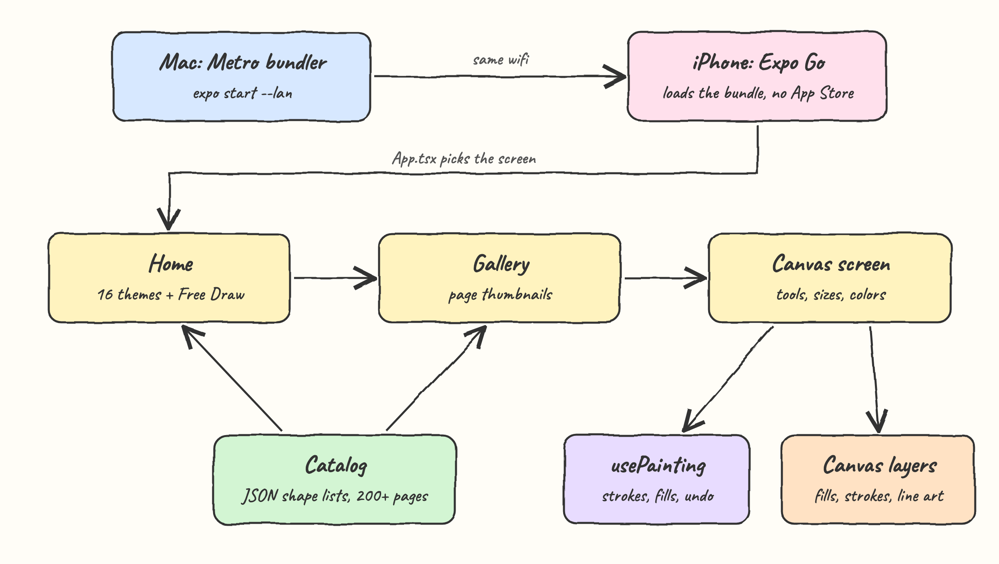
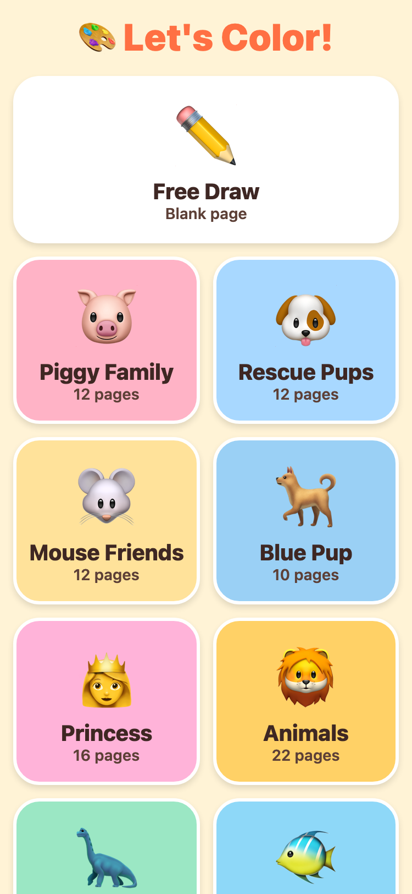
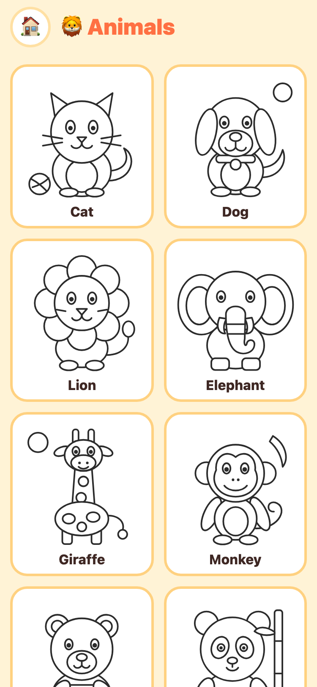
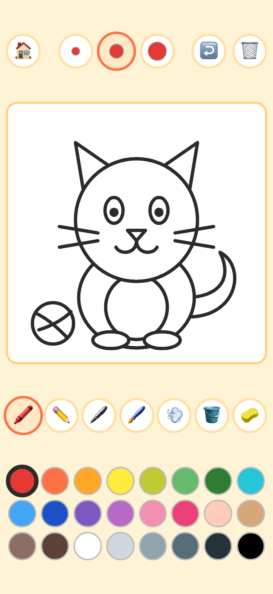
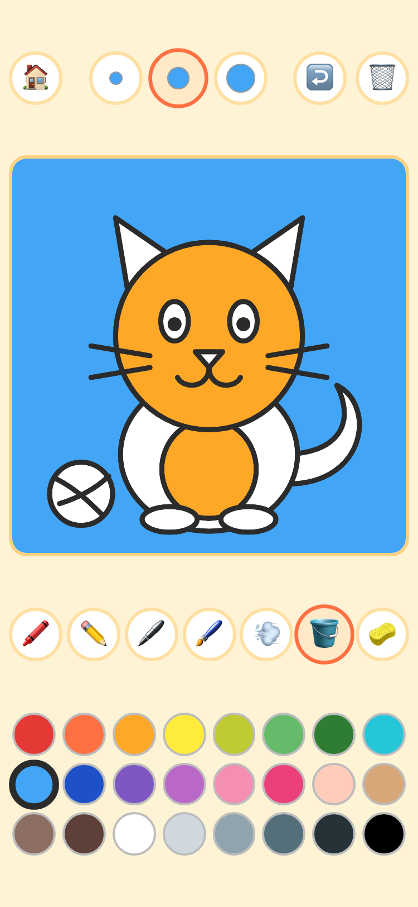
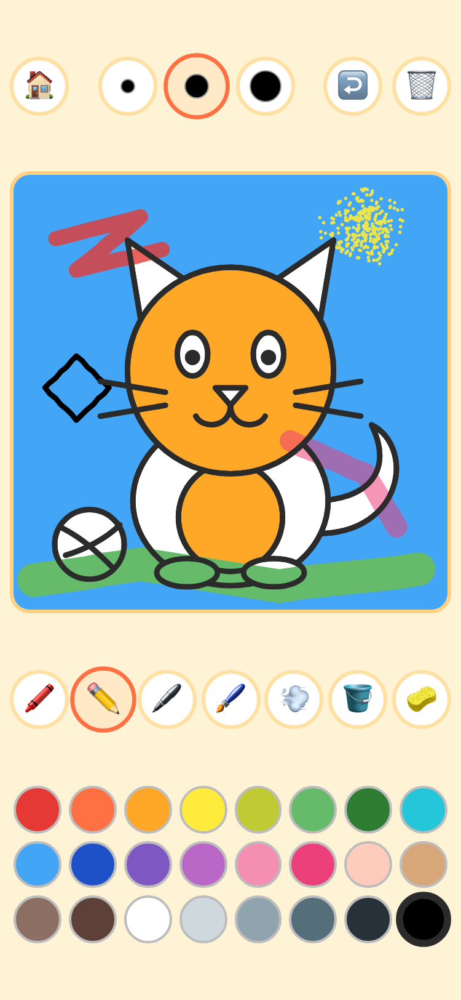
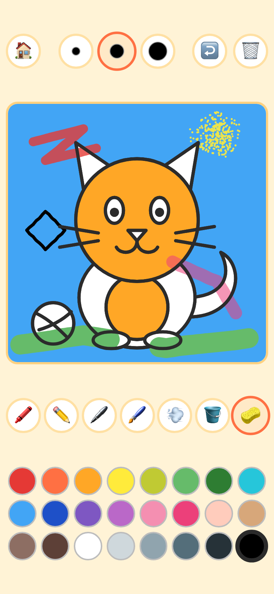

# Kids Drawing

A coloring and drawing app for children aged 4 to 6, built with React Native and Expo.
It ships 226 coloring pages in 16 themes plus a blank page for free drawing, and it runs on an
iPhone over the local wifi through Expo Go, without publishing anything to the App Store.

## How it Works?

1. The home screen shows one big card per theme and a Free Draw card.
2. Tapping a theme opens a gallery with a thumbnail of every page of that theme.
3. Tapping a page opens the canvas with the tools, three brush sizes and 24 colors.
4. The bucket fills a whole region with one tap, which is the easiest way to color for a small child.
5. Crayon, pencil, marker, brush and spray paint freehand with a finger.
6. The sponge erases only what the finger rubs, the arrow undoes the last action and the bin clears the page.
7. The black outline is always drawn on top, so coloring never hides the drawing.
8. Leaving a page keeps its painting, so the child can come back to it while the app is open.

## Architecture



The Mac runs the Metro bundler and the iPhone loads the JavaScript bundle from it through Expo Go.
`App.tsx` holds which theme and page are selected and shows one of three screens. The catalog feeds
the home and gallery screens, and the canvas screen is driven by the `usePainting` hook and rendered
as three stacked SVG layers.

## Features

| Feature | Why |
|---|---|
| 226 coloring pages in 16 themes | Piggy Family, Rescue Pups, Mouse Friends, Blue Pup, Princess, Animals, Dinosaurs, Under the Sea, Farm, Vehicles, Space, Yummy Food, Halloween, Christmas, Summer and Spring. |
| Free Draw | A blank page for drawing anything. |
| Bucket fill | One tap colors a whole region, so a 4 year old gets a good result with no precision. |
| Crayon, pencil, marker, brush, spray | Five freehand tools with different width and opacity. |
| Sponge eraser | Removes only the paint under the finger and never the outline. |
| Three sizes | Big round buttons that preview the size in the current color. |
| 24 colors | Large swatches, no scrolling, no menus. |
| Undo and clear | Up to 40 steps back, and clearing a page can be undone too. |
| Outline always on top | Paint never covers the black lines of the drawing. |
| No reading required | Every control is a picture. |

The character themes are original characters in the spirit of popular preschool cartoons. They are
not the trademarked characters.

## Stack

| Piece | Why |
|---|---|
| Expo SDK 57 | Runs on a real iPhone through Expo Go with no Xcode and no Apple developer account. |
| React Native 0.86 and React 19 | The UI. |
| TypeScript | Typed shapes, strokes and paintings. |
| react-native-svg | Draws the pages and the paint as vectors, sharp at any size. |
| react-native-safe-area-context | Keeps the controls clear of the notch and the home bar. |
| react-native-web and react-dom | Only to preview the app in a desktop browser. |
| Node test runner | Runs the tests with no test library. |

Touch handling uses the `PanResponder` that comes with React Native and navigation is plain React
state, so there is no gesture library and no navigation library.

## Key data structures and design decisions

**A page is a list of shapes.** Every theme is one JSON file in `src/drawings/data/`. A page is an
array of shapes on a 400 by 400 canvas, painted in order so a later shape hides an earlier one.

| Shape | Meaning |
|---|---|
| `["c", cx, cy, r]` | Circle region |
| `["e", cx, cy, rx, ry, rotation]` | Ellipse region, rotation is optional |
| `["r", x, y, w, h, radius]` | Rectangle region, radius is optional |
| `["p", "M ... Z"]` | Closed path region |
| `["l", "M ..."]` | Open detail line, never filled |
| `["d", cx, cy, r]` | Solid black dot |

**A painting is strokes plus fills.** `{ strokes: Stroke[], fills: Record<string, string> }`. A stroke
is `{ tool, color, size, points }` and a fill maps a shape index to a color.

**Three layers.** The canvas stacks three SVGs: the regions with their fill colors, then the freehand
strokes, then the line art. The line art is one dark rectangle seen through a mask in which every
region is black with a white outline, so only the visible outlines show and hidden lines stay hidden.

**The eraser cuts strokes.** Erasing removes the points of a stroke that are under the finger and
splits the stroke in two, so it never paints white over a filled region.

**Points are at most 3 units apart.** A fast drag is filled in with extra points, so the eraser cannot
slip between two points of a stroke.

## How to run on an iPhone without the App Store

The app is not published anywhere. Expo Go is a free app from the App Store that loads the code
straight from the Mac over wifi.

Requirements

* A Mac with Node 20 or newer.
* An iPhone X or newer on iOS 16.4 or newer. The iPhone X stops at iOS 16.7, which is enough. Check it in Settings, General, Software Update.
* The Mac and the iPhone on the same wifi network.

Steps

1. On the iPhone install **Expo Go** from the App Store.
2. On the Mac install the dependencies:
   ```bash
   ./scripts/setup.sh
   ```
3. On the Mac start the app:
   ```bash
   ./scripts/start-all.sh
   ```
   It ends by printing two links. The `iphone` link looks like `exp://<address of the Mac>:8081`.
4. On the iPhone open Expo Go, tap **Enter URL manually**, type the `iphone` link and tap **Connect**.
5. The first time iOS asks if Expo Go can find devices on the local network. Tap **Allow**.
6. The app loads in a few seconds. Hand the phone to the kid.
7. When done, stop it on the Mac:
   ```bash
   ./scripts/stop-all.sh
   ```

Scanning a QR code instead of typing: run `npx expo start --lan` in a terminal, then point the iPhone
Camera at the QR code it prints and tap the Expo Go banner.

If the iPhone cannot connect

* Check that both devices are on the same wifi and that it is not a guest network, which usually blocks devices from seeing each other.
* On the iPhone open Settings, Expo Go and turn **Local Network** on.
* If the macOS firewall asks, allow incoming connections for `node`.
* As a last resort run `npx expo start --tunnel`, which works across networks but is slower.

To keep a child inside the app, turn on Guided Access in Settings, Accessibility, Guided Access and
triple click the side button once the app is open.

## How to run the tests

```bash
./scripts/test-all.sh
```

It typechecks the project and runs 15 tests: the paint logic (eraser, spray, stroke paths) and the
catalog (more than 200 pages, every theme registered, every shape valid).

## Printscreens

The printscreens were taken in a browser at the iPhone X screen size of 375 by 812.

### Home



One card per theme with the number of pages, and the Free Draw card on top.

### Gallery



The pages of the Animals theme. Tapping a thumbnail opens it on the canvas.

### Canvas



A fresh page. The top row has home, the three sizes, undo and clear. Below the page are the seven
tools and the 24 colors.

### Bucket fill



With the bucket selected, three taps colored the head, the belly and the background.

### Freehand tools



Crayon in red, brush in green, spray in yellow, marker in pink and pencil in black. The outline of the
cat stays on top of the paint.

### Eraser



The sponge was rubbed through the green brush stroke. Only the paint under the finger is gone, and the
fills and the outline are untouched.

## Scripts

All scripts live in `scripts/` and run from any directory of the repository.

| Script | What it does |
|---|---|
| `./scripts/setup.sh` | Installs dependencies and prepares the app |
| `./scripts/start-all.sh` | Starts Metro and prints the web link and the iPhone link |
| `./scripts/status.sh` | Shows the Metro port as UP or DOWN |
| `./scripts/test-all.sh` | Runs the typecheck and every test suite |
| `./scripts/ui.sh` | Opens the app in the browser |
| `./scripts/stop-all.sh` | Stops Metro |

Ports are declared in `scripts/ports.env`.

```bash
./scripts/setup.sh
./scripts/start-all.sh
./scripts/status.sh
./scripts/ui.sh
./scripts/stop-all.sh
```
